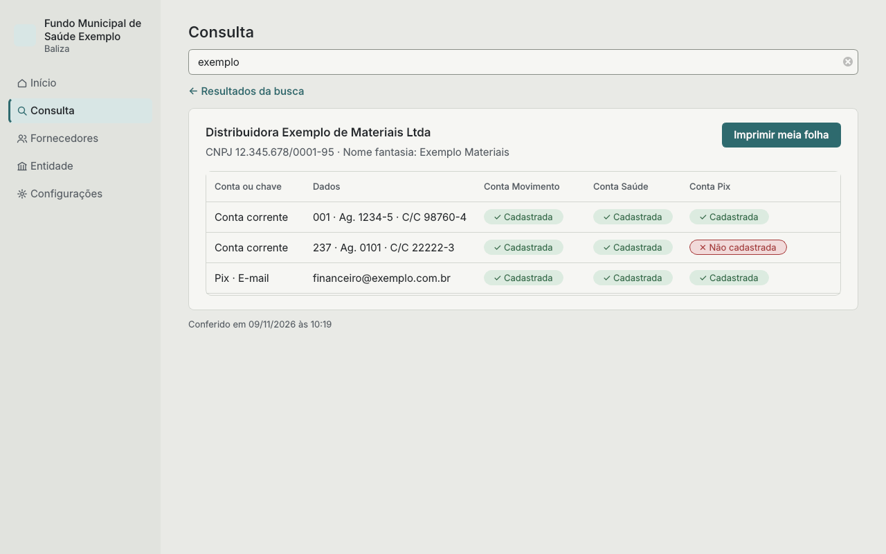
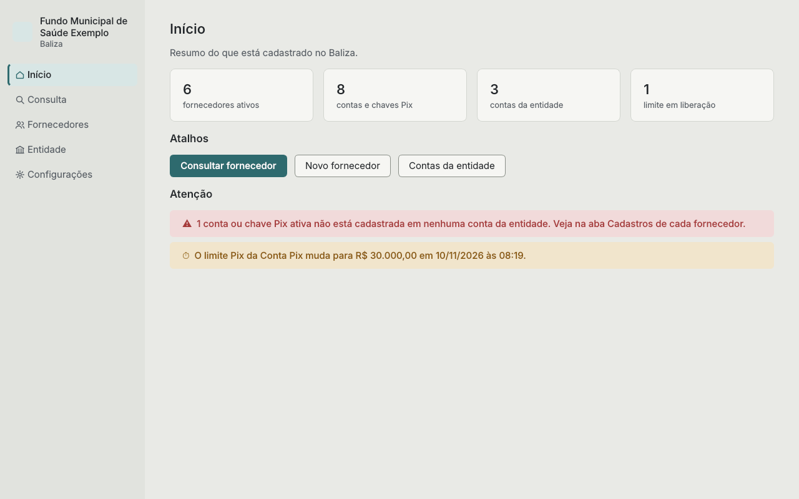
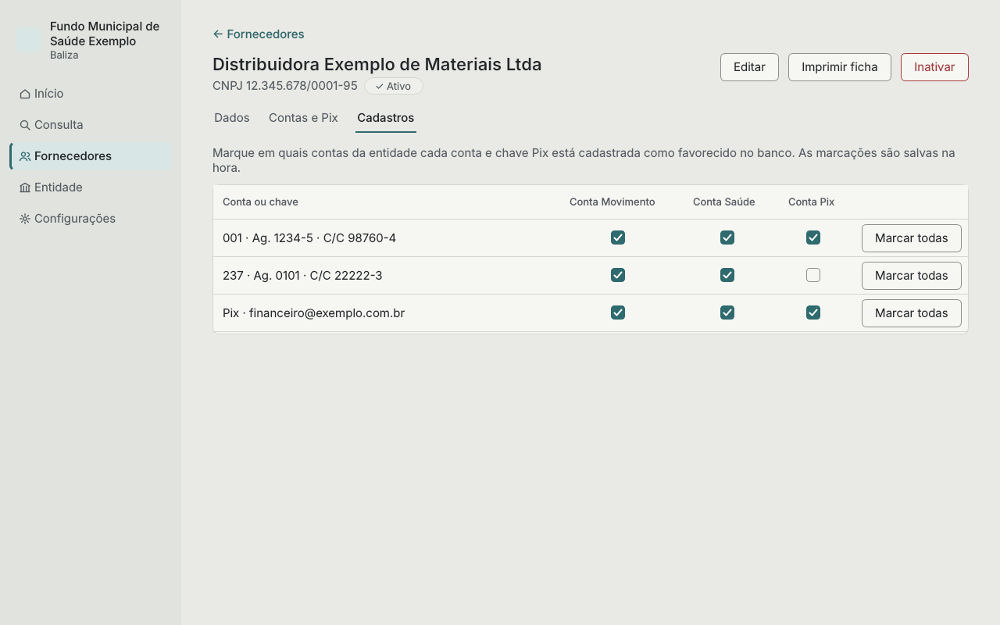

# Baliza

[](https://github.com/alisonvmarques/baliza/actions/workflows/testes.yml)

Sistema desktop e offline para conferir as contas dos fornecedores e em quais contas da
entidade estão cadastradas antes de pagar.

> Versão atual: 0.7 · Painel e backup.



## Para quem é

Para o setor financeiro de entidades que pagam fornecedores por mais de uma conta bancária.
No banco, cada conta da entidade
tem a sua lista de favorecidos: o pagamento só sai para quem está cadastrado naquela conta. O
Baliza registra essa situação e mostra, antes de pagar, de quais contas o pagamento pode sair.

## O que o Baliza faz

- Guarda as contas bancárias e as chaves Pix de cada fornecedor, conferindo CNPJ, CPF,
  agência, conta e chave.
- Registra em quais contas da entidade cada conta e chave está cadastrada como favorecido.
- Na Consulta, mostra o fornecedor com a situação em cada conta da entidade e avisa quando uma
  conta ou chave não está cadastrada em nenhuma.
- Imprime os dados para pagamento em meia folha A4, para anexar ao processo.
- Acompanha os limites diários de Pix e de transação de cada conta da entidade, com a regra de
  24 horas para alterações.
- Funciona totalmente offline, com os dados num arquivo criptografado
  ([como](docs/criptografia.md)), backup automático e exportação para pendrive.

## Instalação

Baixe o instalador na página de
[versões](https://github.com/alisonvmarques/baliza/releases):

| Sistema | Arquivo |
|---|---|
| Windows 10 ou 11 | `Baliza-<versão>-Windows-instalador.exe` |
| Linux (x86_64) | `Baliza-<versão>-Linux-x86_64.AppImage` |
| macOS | `Baliza-<versão>-macOS.dmg` |

O passo a passo de cada sistema, inclusive os avisos de segurança na primeira vez, está em
[Instalação](docs/instalacao.md).

## Como usar

O [guia de uso](docs/index.md) explica cada área, com capturas de tela:

- [Primeiros passos](docs/primeiros-passos.md): senha, chave de recuperação e entidade.
- [Início](docs/inicio.md), [Consulta](docs/consulta.md), [Fornecedores](docs/fornecedores.md),
  [Entidade](docs/entidade.md) e [Configurações](docs/configuracoes.md).
- [Perguntas frequentes](docs/perguntas-frequentes.md).

| Início | Marcações do fornecedor |
|---|---|
|  |  |

Todas as capturas usam dados fictícios.

## Desenvolvimento

Requer Python 3.11 ou mais novo.

```bash
python -m venv .venv
source .venv/bin/activate        # no Windows: .venv\Scripts\activate
pip install -e ".[dev]"
pytest                           # testes
ruff check . && ruff format --check .   # verificação do código
baliza                           # abre o sistema
```

Os testes rodam no GitHub Actions em Windows, Linux e macOS a cada envio. Veja
[como contribuir](CONTRIBUTING.md).

## Licença

[MIT](LICENSE) © 2026 Alison Vasconcelos Marques.
