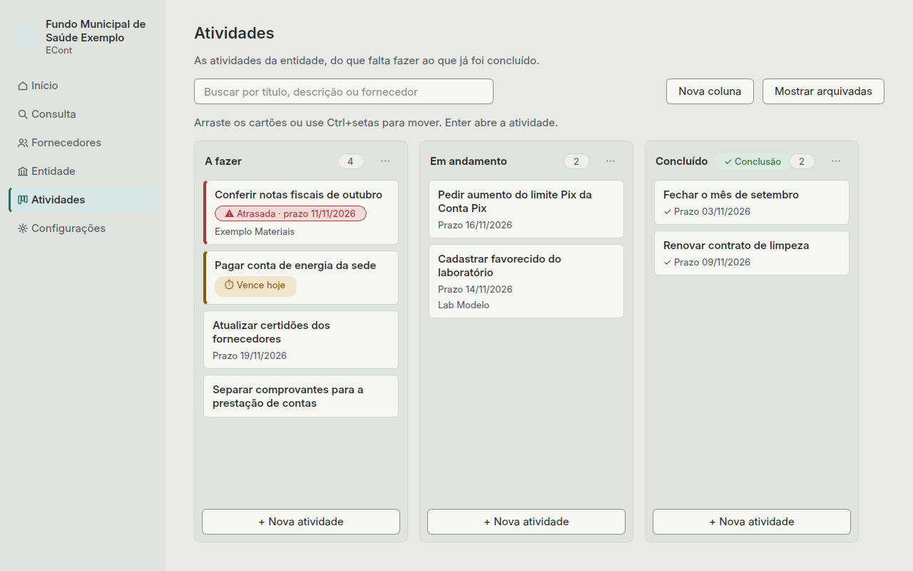
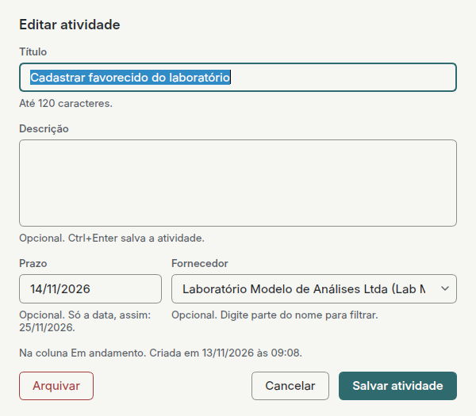

# Atividades

O quadro das atividades da entidade, do que falta fazer ao que já foi concluído. Serve para
acompanhar o trabalho do setor financeiro no próprio ECont, sem outra ferramenta ao lado.

## O quadro

Há um único quadro, o da entidade. Ele começa com três colunas: **A fazer**,
**Em andamento** e **Concluído**. Cada coluna mostra o nome e quantas atividades tem.

Cada cartão mostra o título, o prazo (se houver) e o fornecedor (se houver):

- **Atrasada:** o prazo já passou e a atividade não está na coluna de conclusão. O cartão
  fica com a borda vermelha e a etiqueta "Atrasada".
- **Vence hoje:** borda amarela e a etiqueta "Vence hoje".
- Nos outros casos, o prazo aparece como texto normal.

Atividades atrasadas e que vencem hoje também aparecem no [Início](inicio.md).

## Criar e editar

**+ Nova atividade**, no pé de cada coluna, cria uma atividade no fim daquela coluna.

| Campo | Como preencher |
|---|---|
| Título | Obrigatório, até 120 caracteres |
| Descrição | Opcional, com quantas linhas precisar |
| Prazo | Opcional. Só a data, assim: 25/11/2026 |
| Fornecedor | Opcional. Digite parte do nome para filtrar a lista |

Para editar, dê um duplo clique no cartão ou selecione o cartão e tecle **Enter**. O diálogo
também mostra em que coluna a atividade está e quando foi criada, alterada e movida.

## Mover

- **Arrastando:** segure o cartão e solte em qualquer posição, na mesma coluna ou em outra.
  Uma linha mostra onde ele vai cair.
- **Pelo teclado:** com o cartão selecionado, **Ctrl+←** e **Ctrl+→** levam para o fim da
  coluna vizinha; **Ctrl+↑** e **Ctrl+↓** sobem e descem o cartão na coluna.
- **Pelo menu:** clique com o botão direito no cartão (ou tecle **Menu**).

O ECont grava cada troca de coluna com a data e os nomes das colunas.

## Buscar

O campo de busca, no topo, filtra os cartões por título, descrição e nome do fornecedor
enquanto você digita, sem diferenciar maiúsculas e acentos. Com a busca ativa, cada coluna
mostra quantas atividades estão à mostra ("1 de 4"), e dá para arrastar normalmente: o cartão
cai no lugar certo mesmo com outros cartões escondidos.

## Arquivar, restaurar e excluir

- **Arquivar** tira a atividade do quadro sem apagar. Está no menu do cartão e no diálogo da
  atividade, e pede confirmação.
- **Mostrar arquivadas** lista as atividades arquivadas:
  - **Restaurar** devolve a atividade para o fim da coluna de onde ela saiu.
  - **Excluir definitivamente** apaga a atividade e o histórico dela. Pede confirmação e não
    dá para desfazer. Só atividades arquivadas podem ser excluídas.

## Colunas

**Nova coluna** cria uma coluna à direita das outras. O botão **⋯** no cabeçalho de cada
coluna tem **Editar coluna**, **Mover para a esquerda**, **Mover para a direita** e
**Excluir coluna**.

- O nome é obrigatório e não pode repetir outro (sem diferenciar maiúsculas e acentos).
- Só dá para excluir uma coluna vazia, sem atividades no quadro nem arquivadas. Mova ou
  exclua as atividades antes. O quadro sempre fica com pelo menos uma coluna.
- Uma coluna pode ser a **coluna de conclusão** (no começo, **Concluído**). Atividade nela
  conta como concluída e nunca aparece como atrasada. Só uma coluna pode ser de conclusão:
  marcar outra desmarca a anterior.

## Fornecedor inativo ou excluído

Uma atividade ligada a um fornecedor inativo continua mostrando o nome dele, com
"(inativo)". Se o fornecedor for excluído, a atividade continua no quadro, só sem o
fornecedor.

## Backup

As atividades ficam no mesmo arquivo protegido dos outros dados. Entram no backup, na
exportação e na restauração como todo o resto.
