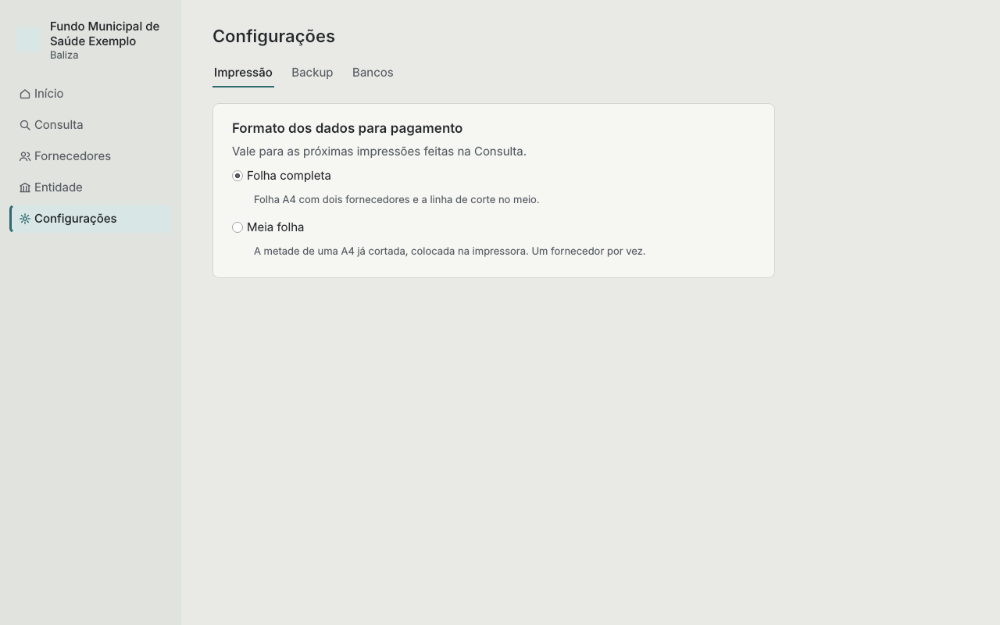

# Configurações

## Impressão

O formato dos dados para pagamento impressos na [Consulta](consulta.md#imprimir-os-dados-para-pagamento):

- **Folha completa:** A4 com dois fornecedores e a linha de corte no meio.
- **Meia folha:** a metade de uma A4 já cortada, colocada na impressora. Um fornecedor por vez.

## Backup

- **Backup automático:** ao fechar o Baliza, uma cópia dos dados vai para a pasta `backups`,
  ao lado do arquivo de dados. Fica ligado de fábrica.
- **Quantas cópias guardar:** de 1 a 60 (7 de fábrica). As mais antigas são apagadas.
- **Exportar backup…** salva uma cópia onde você escolher: um pendrive ou outro disco. Faça
  isso com frequência e guarde longe do computador.
- **Restaurar backup…** substitui os dados atuais pelos de um backup. Pede a senha ou a chave
  de recuperação **que valiam quando o backup foi feito**. Antes de substituir, os dados atuais
  viram um backup, então nada se perde.

Os backups são criptografados como o arquivo de dados.

## Bancos

A lista oficial de bancos do Banco Central já vem no Baliza. **Cadastrar banco** é só para um
banco que ainda não está na lista: informe o código e o nome.
