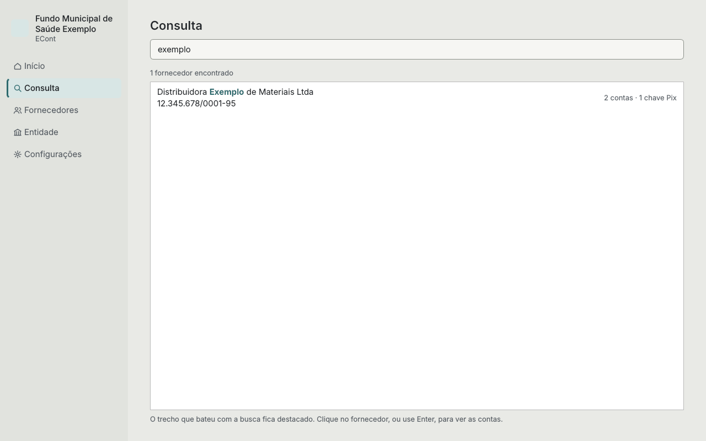
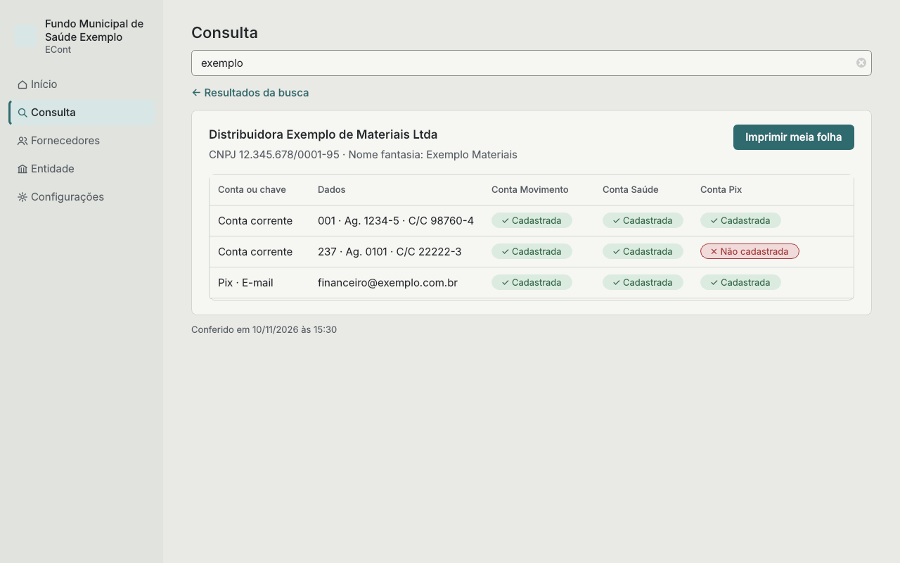

# Consulta

A Consulta é o que se usa na hora de pagar: mostra, para cada conta e chave Pix do
fornecedor, se ela está cadastrada como favorecido em cada conta da entidade.

## Buscar

Digite parte do nome, do nome fantasia ou do CNPJ/CPF. Não importa se tem acento, maiúscula
ou pontuação. Só aparecem fornecedores ativos.

- **Enter** abre o primeiro da lista; a seta para baixo leva à lista.
- **Esc** limpa a busca.

## O resultado

Cada linha é uma conta bancária ou chave Pix ativa do fornecedor; cada coluna, uma conta ativa
da entidade:

- **Cadastrada:** o pagamento pode sair dessa conta da entidade.
- **Não cadastrada:** antes de pagar por essa conta da entidade, cadastre o favorecido no
  banco e marque na aba **Cadastros** do fornecedor.

Se uma conta ou chave não está cadastrada em nenhuma conta da entidade, aparece um aviso
vermelho em cima: não use essa conta ou chave para pagar.

No rodapé fica a data e a hora da conferência.

## Imprimir os dados para pagamento

**Imprimir meia folha** imprime os dados do fornecedor com a situação de cada conta, para
anexar ao processo de pagamento. O formato é escolhido em
**Configurações › Impressão** (veja [Configurações](configuracoes.md)):

- **Folha completa:** uma folha A4 tem espaço para dois fornecedores, com a linha de corte no
  meio. Ao imprimir um fornecedor, o ECont pergunta se imprime agora, com a metade de baixo em
  branco, ou se guarda para sair junto com o próximo fornecedor impresso.
- **Meia folha:** para quem já deixa folhas A4 cortadas ao meio na impressora. Sai um
  fornecedor por vez.

Antes de imprimir, aparece a pré-visualização, com a opção de salvar em PDF.
