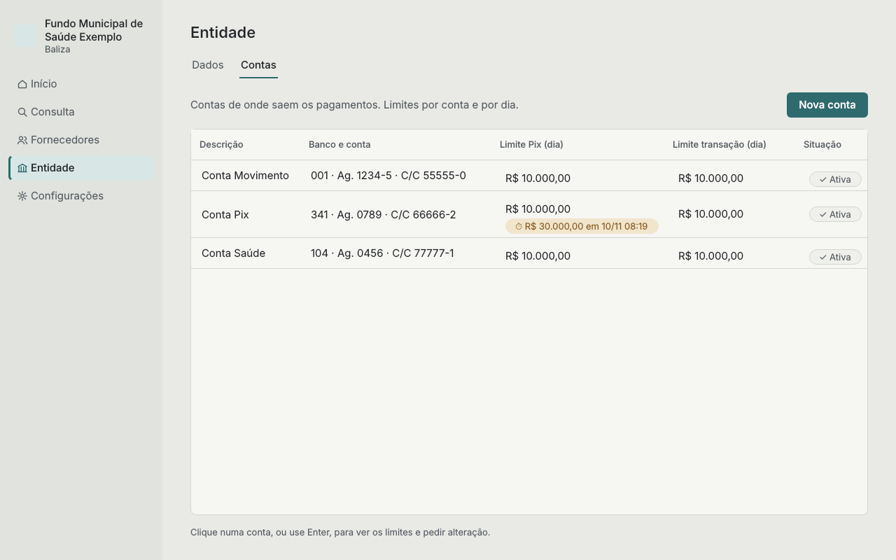

# Entidade

A entidade é quem paga. O Baliza cadastra uma única entidade.

## Dados

Razão social, CNPJ e o logo (opcional: PNG ou JPG, até 1 MB). O logo e o nome aparecem na
barra lateral e nas impressões.

## Contas

As contas da entidade de onde saem os pagamentos. Cada uma vira uma coluna na Consulta e na
aba **Cadastros** dos fornecedores.

**Nova conta** pede uma descrição (por exemplo, "Conta Movimento"), o banco, a agência e a
conta com o dígito.

## Limites

Cada conta tem dois limites diários: Pix e transação. Toda conta começa com
R$ 10.000,00 nos dois.

Para registrar uma alteração pedida no banco, clique na conta, escolha o limite, informe o
novo valor e a data e hora do pedido, e clique em **Registrar pedido**. Como no banco, o novo
valor só passa a valer 24 horas depois do pedido. Enquanto isso, a conta mostra o valor em
liberação e quando ele começa a valer, e o [Início](inicio.md) também avisa.

## Inativar uma conta

**Inativar conta** tira a conta da Consulta e das marcações, mas guarda o histórico. Reativar
traz tudo de volta.
