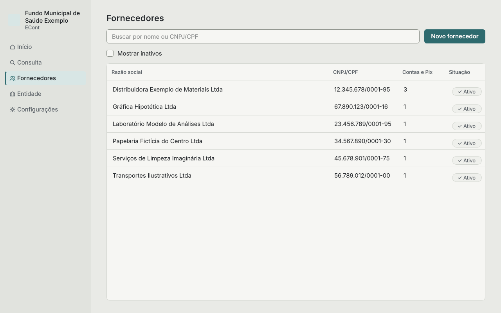
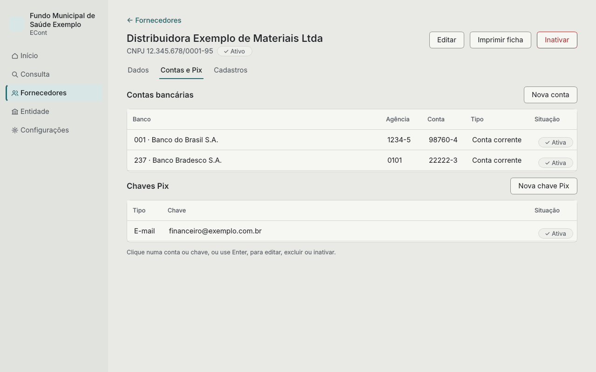
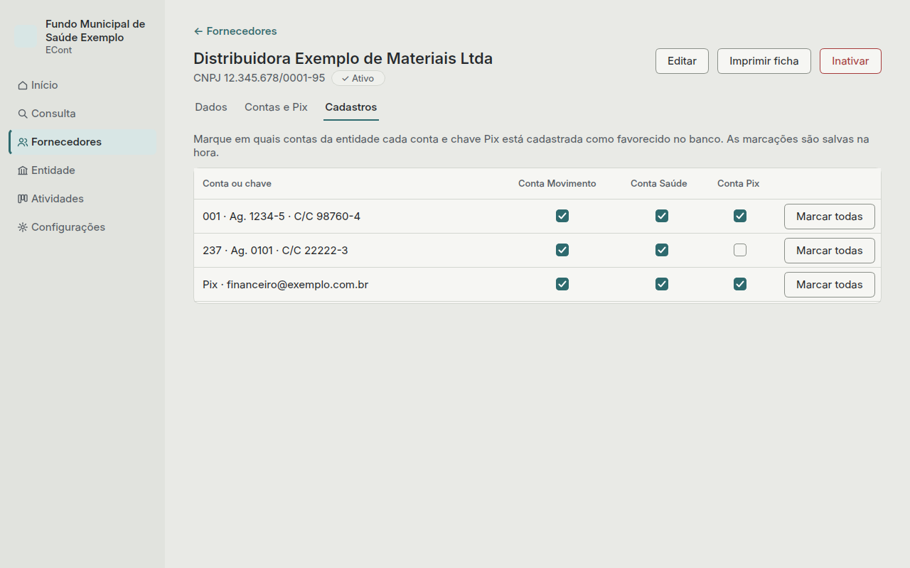

# Fornecedores

Aqui ficam os fornecedores, com as contas bancárias, as chaves Pix e as marcações de onde cada
uma está cadastrada.

## Cadastrar um fornecedor

Clique em **Novo fornecedor** e escolha pessoa jurídica ou pessoa física.

- **CNPJ ou CPF:** obrigatório e conferido pelos dígitos verificadores. O CNPJ com letras,
  que começa a valer em 2026, também é aceito. Um mesmo documento não pode estar em dois
  fornecedores.
- **Razão social** (ou nome, para pessoa física): obrigatória.
- Nome fantasia, telefone, e-mail, endereço e observações são opcionais.

Digite só os números: CNPJ, CPF e telefone ganham os pontos, a barra, o traço e os parênteses
enquanto você digita. O mesmo vale para a chave Pix de CNPJ, CPF ou telefone e para o CNPJ da
entidade. Telefone começando com 0 (como 0800) ou com +, ou com texto, fica como foi digitado.

Enter em qualquer campo salva.

## A ficha do fornecedor

Clique num fornecedor (ou use Enter na lista) para abrir a ficha. Ela tem três abas.

### Dados

Os dados do cadastro. **Editar** altera; **Imprimir ficha** gera a ficha completa em A4, com
pré-visualização e opção de salvar em PDF.

### Contas e Pix

- **Nova conta:** banco (da lista oficial), agência, conta com o dígito depois do traço e o
  tipo (corrente, poupança ou pagamento).
- **Nova chave Pix:** CNPJ, CPF, e-mail, telefone ou aleatória. A chave de CNPJ ou CPF tem de
  ser o documento do próprio fornecedor; o telefone precisa ser do Brasil.

Se a mesma conta ou chave já estiver em outro fornecedor, o ECont avisa quem é. Para gravar
mesmo assim, clique uma segunda vez em **Salvar mesmo assim**.

Clique numa conta ou chave para editar, excluir ou inativar.

### Cadastros

Cada linha é uma conta ou chave do fornecedor; cada coluna, uma conta da entidade. Marque a
caixa quando a conta ou chave estiver cadastrada como favorecido naquela conta da entidade,
no banco. A marcação é salva na hora.

**Marcar todas** marca a linha inteira, depois de confirmar. Linhas sem nenhuma marcação
ficam em destaque.

## Inativar ou excluir

- **Excluir** só aparece para fornecedor, conta ou chave sem histórico de marcações. Pede
  confirmação.
- **Inativar** é para o que já tem histórico: deixa de aparecer na Consulta e não recebe
  marcações novas, mas o histórico fica guardado. Dá para reativar depois, sem perder nada.

Toda confirmação tem **Cancelar** como botão padrão: Enter sem pensar não apaga nada.
