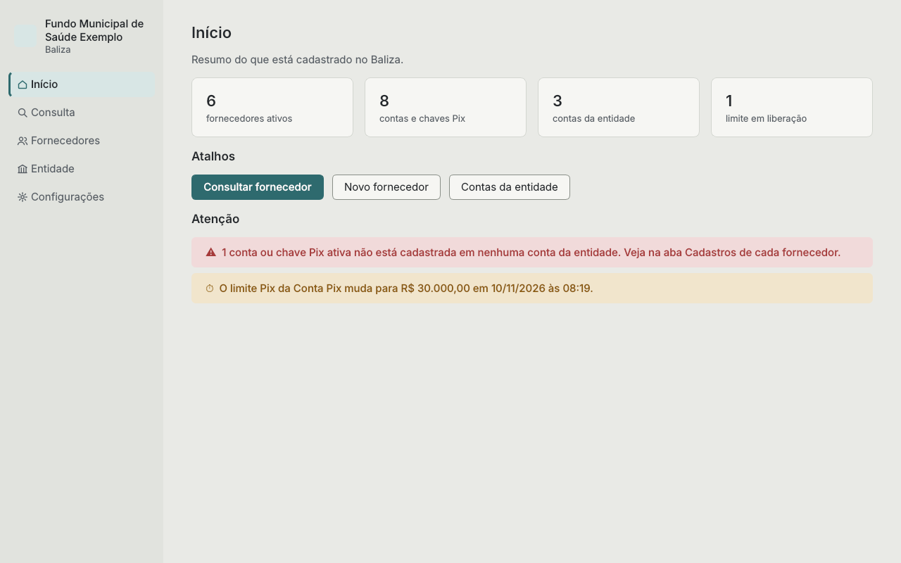

# Início

O Início é a primeira tela depois de entrar. Mostra quantos fornecedores ativos, contas e
chaves Pix e contas da entidade estão cadastrados, e quantos limites estão em liberação.

## Atalhos

- **Consultar fornecedor** abre a [Consulta](consulta.md).
- **Novo fornecedor** abre o formulário de fornecedor.
- **Contas da entidade** abre **Entidade › Contas**.

## Atenção

Aparece só quando há algo a resolver:

- **Conta ou chave Pix sem cadastro:** uma conta ou chave ativa de fornecedor que não está
  marcada em nenhuma conta da entidade. Não dá para pagar por ela até cadastrar o favorecido
  no banco e marcar na aba **Cadastros** do fornecedor.
- **Limite em liberação:** um pedido de alteração de limite que ainda não passou das 24 horas.
  Mostra o novo valor e quando ele passa a valer.
