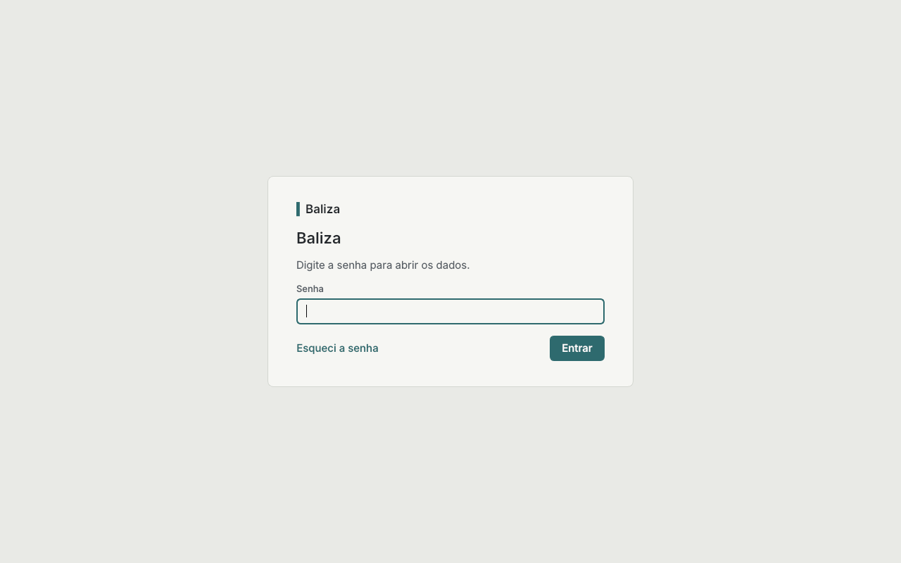

# Primeiros passos

Na primeira vez que abre, o Baliza pede três coisas, nesta ordem.

## 1. Criar a senha

A senha protege o arquivo de dados e é pedida toda vez que o Baliza abre. Precisa ter pelo
menos 10 caracteres, com letras e números.

## 2. Guardar a chave de recuperação

Em seguida o Baliza mostra a chave de recuperação. Ela é a única forma de entrar se a senha
for esquecida: sem a senha e sem a chave, ninguém abre os dados, nem quem fez o sistema.

Imprima a chave ou salve em PDF e guarde fora do computador, num lugar seguro. Só depois
clique em **Continuar**. Se o Baliza for fechado antes disso, ele gera uma chave nova na
próxima vez e a anterior deixa de valer.

## 3. Dados da entidade

A entidade é quem paga: informe a razão social e o CNPJ. O logo é opcional (PNG ou JPG, até
1 MB) e aparece na barra lateral e nas impressões.

## Depois disso

1. Cadastre as contas da entidade em **Entidade › Contas** (veja [Entidade](entidade.md)).
2. Cadastre os fornecedores, com as contas bancárias e as chaves Pix (veja
   [Fornecedores](fornecedores.md)).
3. Na aba **Cadastros** de cada fornecedor, marque em quais contas da entidade cada conta e
   chave já está cadastrada como favorecido no banco.
4. Na hora de pagar, use a [Consulta](consulta.md).

## Usar só o teclado

- **Ctrl+1** a **Ctrl+5** trocam de área.
- **Enter** salva formulários e diálogos; **Esc** cancela os diálogos.
- **Tab** passa de um campo para o outro; **Espaço** marca e desmarca caixas.
- **Ctrl+Tab** passa para a próxima aba.
